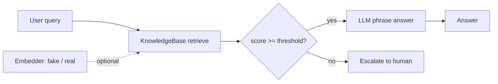

<p align="center">
  
</p>

<h1 align="center">AI Customer Support Bot</h1>

<p align="center">
  <strong>Knowledge-base retrieval with confidence-based escalation — in Python.</strong><br>
  Answer FAQs automatically when the bot is confident, hand off to a human when it is not.
</p>

<p align="center">
  <em>Built and maintained by <a href="https://viprasol.com">Viprasol Tech</a> — Fintech Experts. Full-Stack Builders.</em>
</p>

<p align="center">
  <a href="https://github.com/Viprasol-Tech/ai-customer-support-bot/actions/workflows/ci.yml"></a>
  <a href="LICENSE"></a>
  
  <a href="https://t.me/viprasol_help"></a>
  <a href="https://github.com/Viprasol-Tech/ai-customer-support-bot/stargazers"></a>
</p>

---

> **Provider-agnostic and offline-capable.** The LLM and embedder are simple pluggable
> callables (`Callable[[str], str]` and `Callable[[str], list[float]]`). A built-in
> deterministic **fake** provider ships in the box, so the demo and the entire test suite
> run with **no network, no API keys, and no heavy SDKs**. Swap in OpenAI, a local model,
> or anything else by passing your own callable — the retrieval, scoring, and escalation
> logic stays exactly the same.

> _Note: this is a reference implementation — not production-hardened. Review before use._

---

## ✨ Features

- 🔎 **Real retrieval** — term-overlap (Jaccard) out of the box, or genuine cosine
  similarity when you plug in an embedder.
- 🎚️ **Confidence-based escalation** — answers when the match score meets your threshold,
  otherwise returns an escalation result carrying the original query for a human agent.
- 🔌 **Pluggable providers** — bring any LLM/embedder as a plain callable; no vendor lock-in.
- 🧪 **Fully offline** — built-in hash-based fake embedder + templated fake LLM mean tests
  and the demo never touch the network.
- 🖥️ **CLI** — `ai-customer-support-bot demo` answers a known question and escalates an
  unknown one.
- ⚙️ **Modern tooling** — ruff, mypy (strict), pytest, GitHub Actions CI.

## 🚀 Quickstart

```bash
git clone https://github.com/Viprasol-Tech/ai-customer-support-bot.git
cd ai-customer-support-bot
python -m pip install -e ".[dev]"

# Term-overlap retrieval (default):
ai-customer-support-bot demo

# Embedding-cosine retrieval with the built-in fake embedder:
ai-customer-support-bot demo --embeddings --threshold 0.25
```

## 🧩 Plug in a real provider

The fakes are swappable for any backend. An LLM is just `str -> str` and an embedder is
just `str -> list[float]`:

```python
from ai_customer_support_bot.bot import SupportBot
from ai_customer_support_bot.kb import KnowledgeBase


def my_embedder(text: str) -> list[float]:
    # e.g. call your embedding API / local model here
    return real_embed(text)


def my_llm(prompt: str) -> str:
    # e.g. call your chat model here to phrase the answer
    return real_complete(prompt)


kb = KnowledgeBase(embedder=my_embedder)
kb.add_qa("How do I reset my password?", "Open Settings > Security and reset it.")
kb.add_qa("How do I get a refund?", "Refunds take 5-7 business days.")

bot = SupportBot(kb, threshold=0.3, llm=my_llm)

reply = bot.answer("I forgot my password, how do I reset it?")
if reply.escalated:
    route_to_human(reply.query)
else:
    print(reply.answer, f"(confidence {reply.score:.2f})")
```

## 🏗️ Architecture



## 🗺️ Roadmap

- [x] FAQ knowledge base with term-overlap and embedding-cosine retrieval
- [x] Confidence-gated answer/escalate bot with pluggable LLM
- [x] Built-in deterministic fake providers for offline demo + tests
- [ ] Multi-turn conversation context
- [ ] Persistent vector store adapters
- [ ] Analytics on escalation rate and answer confidence

## 🤝 Contributing

PRs welcome — see [CONTRIBUTING.md](CONTRIBUTING.md) and our [Code of Conduct](CODE_OF_CONDUCT.md).

## Contact — Viprasol Tech Private Limited

- Website: [viprasol.com](https://viprasol.com)
- Email: [support@viprasol.com](mailto:support@viprasol.com)
- Telegram: [t.me/viprasol_help](https://t.me/viprasol_help) | WhatsApp: +91 96336 52112
- GitHub: [@Viprasol-Tech](https://github.com/Viprasol-Tech) | [LinkedIn](https://www.linkedin.com/in/viprasol/) | X [@viprasol](https://twitter.com/viprasol)

## License

[MIT](LICENSE) (c) 2025 Viprasol Tech Private Limited
